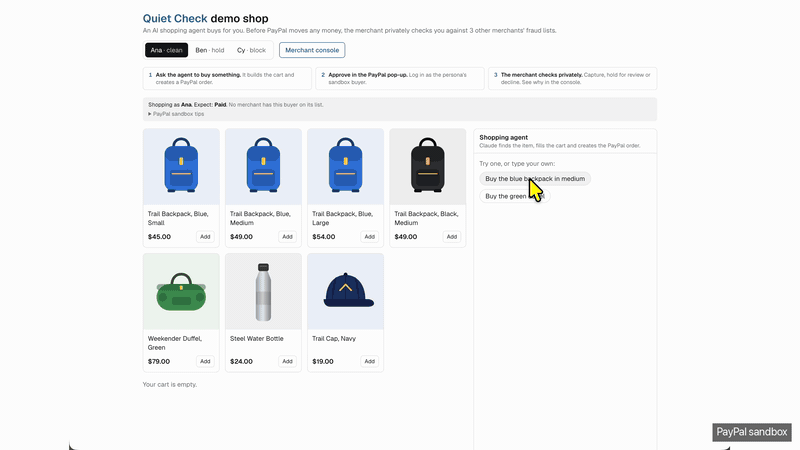
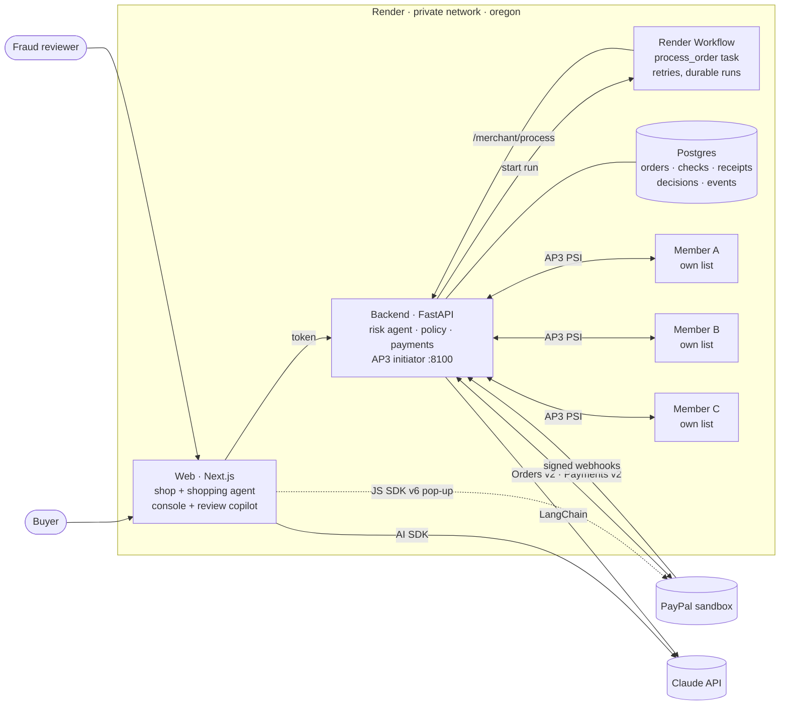

# Quiet Check

When an AI agent buys on someone's behalf, the merchant's own agent privately checks the buyer against other merchants'
fraud lists, then uses PayPal to capture, hold or decline the payment. No merchant ever shares its list.

Built for the PayPal AI Hackathon 2026 (solo entry by Vic Kaul). PayPal sandbox only; all data is synthetic.

**[Live demo](https://quietcheck-web.onrender.com)** · **[Judges' summary](https://quietcheck-report.onrender.com)** ·
merchant console at [`/console`](https://quietcheck-web.onrender.com/console) (password in the Devpost testing
instructions) · **[Video (2:51)](https://youtu.be/4CmrLt8f9fo)**



| 9 | 14-18 s | 0 | 134 |
| --- | --- | --- | --- |
| private checks per order (3 identifiers x 3 merchants) | buyer approval to final decision, hosted (measured) | list entries that ever leave their owner | automated tests, plus live sandbox runs |

## Contents

[The problem](#the-problem) · [What it does](#what-it-does) · [Who saw what](#who-saw-what) ·
[Architecture](#architecture) · [AI tools used](#ai-tools-used) · [Try it hosted](#try-it-hosted) ·
[Run it locally](#run-it-locally) · [Tests](#tests) · [Limits](#limits) · [Licence and credits](#licence-and-credits)

## The problem

A purchase made by an AI agent arrives without most of what fraud tools read: no mouse movement, no typing rhythm, no
browsing path. Industry reporting from MPE 2026 says agentic transactions strip away the behavioural markers current
tools rely on [[1]](#sources), and fraud liability for agent pilots is still unclear [[2]](#sources).

What still identifies a repeat abuser is the plain stuff: email, shipping address, device. Another merchant may already
have this buyer on its chargeback list. But merchants can't hand customer lists to competitors: privacy law limits
sharing personal data to what is necessary and proportionate [[3]](#sources), and a list is a commercial asset. Shared
fraud intelligence today runs through a vendor that receives every member's data, and hashing the lists doesn't help,
because emails and addresses are guessable (our assessment).

[AP3](https://silencelaboratories.com/ap3), an open protocol that lets agents from different companies compute on
private data without revealing it, makes a different design possible. Silence Laboratories contributed it to LF
Decentralized Trust; it is in research preview [[4]](#sources) [[5]](#sources).

**What it's worth** (industry figures; how far Quiet Check moves them in production is not yet measured):

- **Trust:** 55% of US and UK consumers are uncomfortable letting an AI agent buy for them, and 54% think AI could raise
  fraud risk [[9]](#sources). Quiet Check gives every agent order a peer fraud check before money moves, with a signed
  receipt for each check.
- **Cost:** each $1 of fraud costs a US retail or ecommerce merchant $4.61 once chargebacks, fees, labour and
  replacement goods are counted [[10]](#sources). A blocked order is never authorised, so no capture, refund or
  chargeback follows.
- **Conversion:** 32% of US consumers say they stop shopping with a merchant after being declined [[11]](#sources).
  One weak signal holds the funds for a human instead of declining.
- **For PayPal:** PayPal aims to be the trusted execution layer for agent payments, whichever protocol wins
  [[8]](#sources). Each merchant that joins makes the check better for the others, and the action at the end is always a
  PayPal authorise, capture or void (our assessment).

## What it does

1. **Shop.** The buyer tells the shopping agent "buy the blue backpack in medium". It finds the item, builds the cart
   and creates a PayPal order with intent `AUTHORIZE`, priced by the backend, never the agent. The buyer approves in the
   PayPal pop-up.
2. **Check.** The merchant's risk agent asks three consortium merchants (Members A, B, C) whether they hold the buyer's
   email, shipping address or device ID: 3 x 3 = 9 AP3 private set intersection (PSI) sessions, run at once. Each answer
   is a yes or no; no list leaves its owner, and every session is stored as a signed, verified receipt.
3. **Decide.** A fixed rule decides, and Claude explains the decision in 2-3 sentences. It can explain the decision but
   never change it.

   | Hits | Decision | PayPal action |
   | --- | --- | --- |
   | 0 | `clean` | Authorise, then capture |
   | 1 | `hold` | Authorise only (funds held); queue for human review |
   | 2 or more, or email and device both hit | `block` | Don't authorise; the order expires |

4. **Review.** In the merchant console a reviewer sees the receipts, a 3x3 hit grid and a "who saw what" panel, asks the
   review copilot about the hold, and on their instruction plus one Approve click the copilot captures or voids the
   payment in PayPal. The console counts down PayPal's 3-day honour period for capturing a hold.
5. **Dispute.** If a buyer later disputes a captured payment, the verified webhook brings the dispute into the console,
   Claude drafts the merchant's evidence from the receipts and decision log, and a reviewer edits and submits it to
   PayPal.

**Three demo buyers, same shop, same item, three outcomes:**

| Persona | Seeded on | Hits | Outcome | Buyer sees |
| --- | --- | --- | --- | --- |
| Ana | Nothing | 0 | Authorised and captured | "Paid" |
| Ben | Member B (email) | 1 | Authorised only, held for review | "Payment on hold for review" |
| Cy | Members A and C (email and device) | 4 | Never authorised, no money moves | "We couldn't complete this order" |

Each member holds about 300 synthetic entries with the personas seeded on purpose. In three back-to-back hosted runs on
2026-10-14 and three more on 2026-10-16, all 18 orders came out right, each with 9 of 9 receipts verified (measured).

### PayPal integration

Every PayPal call in the demo hits the live sandbox. Nothing on screen is mocked.

| PayPal piece | What we use it for |
| --- | --- |
| JS SDK v6 | Buyer approval in the PayPal pop-up, started from the agent's order |
| Orders v2 | Create with intent `AUTHORIZE`; read payer email and shipping after approval; authorise |
| Payments v2 | Capture a clean order; capture or void a held one on the reviewer's instruction |
| Webhooks | `CHECKOUT.ORDER.APPROVED` starts the risk agent; capture, void and dispute events confirm state. Signatures verified, events deduped |
| Idempotency | `PayPal-Request-Id` on every money-moving call, so retries can't double-charge |
| Disputes v1 | Read the dispute; submit the reviewer's evidence with provide-evidence |

### AP3 integration

The consortium runs on the open-source AP3 SDK (`ap3[a2a]`, `ap3-functions` 1.2.2) [[4]](#sources).

| AP3 piece | What we use it for |
| --- | --- |
| A2A agents | Members A, B and C are separate A2A servers, each holding only its own list |
| AgentCards | Roles (initiator, receiver) and each member's signed commitment to its list (size, format, digest) |
| PSI | 9 sessions per order: "is this value in your set?", answered yes or no [[5]](#sources) |
| Directives | Each session's signed intents are captured; receipts are verified before they are stored |

## Who saw what

The console shows this panel on every order, because privacy claims should be specific:

| Party | Sent | Learned | Never saw |
| --- | --- | --- | --- |
| Merchant (us) | Blinded hashes of email, address, device | Match yes/no per member per field | Any member's list |
| Member A, B or C | Its PSI responses (unsigned) and its signed commitment | Nothing about the query or result | The buyer's identifiers; other members' lists |
| PayPal | Payer details; payment status | Order, authorisation, capture or void | Any fraud list or check result |
| The AI model | - | The hit summary only (which member matched which field) | Raw lists, other buyers' data; for dispute drafts, also the payer's email, address and device |

Note the first row: PSI tells the checking merchant which member matched which field. "Count only" is future work (see
[Limits](#limits)).

## Architecture

Seven pieces on Render, one private network. Only the shop and the backend are public. The backend accepts
unauthenticated calls only for health, PayPal's signed webhooks and the order status; everything else needs a token.
Members are private services that answer only the backend's AP3 initiator.



| Layer | Choice |
| --- | --- |
| Backend | Python 3.12, FastAPI, SQLAlchemy Core; SQLite locally, Postgres on Render |
| Consortium | AP3 SDK 1.2.2; three member agents (local processes, or Render private services) |
| Web | Next.js 16, React 19, Tailwind 4, Vercel AI SDK v7 |
| Orchestration | Render Workflows runs each order's check -> decide -> PayPal action with retries; an in-process fallback takes over within 45 s if a run stalls. Locally the risk agent runs in-process |
| Operations | Deep health check (database, each member's list digest, workflow); a sweep reruns orders stuck mid-check; a scheduled synthetic check emails on failure |

Locally the same pieces run as processes: backend on `:8000` (AP3 initiator on `:8100`), Members A-C on `:8101-8103`,
web on `:3000`, SQLite instead of Postgres, no token or console password.

## AI tools used

**Inside the product.** All models are Anthropic's Claude, behind a swap layer (`LLM_PROVIDER`, `LLM_MODEL_FAST`,
`LLM_MODEL_SMART`), with prompts in [`prompts/`](prompts/). The AI explains and assists; it never makes the decision
and can't move money on its own.

| Where | Model | Library | What it does |
| --- | --- | --- | --- |
| Shopping agent (`web/app/api/chat/route.ts`) | Claude Haiku 5.5 (`LLM_MODEL_FAST`) | Vercel AI SDK v7, `@ai-sdk/anthropic` | Turns a sentence into a product search, a cart and a PayPal order, with three tools |
| Risk rationale (`backend/app/rationale.py`) | Claude Haiku 5.5 (`LLM_MODEL_FAST`) | LangChain `init_chat_model` | Explains each decision in 2-3 sentences from the hit summary only. After any error or 10 s, a template stands in |
| Review copilot (`web/app/api/console/chat/route.ts`) | Claude Haiku 5.5 (`LLM_MODEL_FAST`) | Vercel AI SDK v7 tool approval | Answers "why is this on hold?"; captures or voids only after the reviewer clicks Approve on a signed card showing the order, amount and action |
| Dispute evidence (`backend/app/disputes.py`) | Claude Sonnet 5.5 (`LLM_MODEL_SMART`) | LangChain `init_chat_model` | Drafts the merchant's evidence from the receipts, decision and PayPal timeline, without the buyer's identifiers. A person edits and submits it. A template stands in on failure |

Guardrail: the backend recomputes the policy from the stored receipts and rejects any decision the policy didn't make
(`409 policy_mismatch`). A swap to Sonnet for the fast tasks was tested live (measured).

**Used to build it.** The code, tests and docs were written with Claude Code (Claude Opus 5.5) under Vic's direction;
commits it co-authored carry a `Co-Authored-By` trailer. The demo video's narration is ElevenLabs text-to-speech
(voice: elevenlabs.io).

## Try it hosted

1. Open https://quietcheck-web.onrender.com and pick a persona (Ana, Ben or Cy).
2. Ask the shopping agent "buy the blue backpack in medium", then approve in the PayPal pop-up **as that persona's
   sandbox buyer**. The logins are in the Devpost testing instructions, not in this repo.
3. Watch the status change to paid, on hold or declined (about 15 s).
4. Open `/console` (any username; the password is in the testing instructions), click the order and ask the copilot
   about a held order.

Log out at https://www.sandbox.paypal.com before switching buyers: the PayPal pop-up reuses the last login, even
across incognito windows. The first order after a quiet spell can take up to about 30 s (measured).

## Run it locally

About 15 minutes, most of it the PayPal sandbox setup. You need macOS or Linux, [uv](https://docs.astral.sh/uv/)
(it fetches Python 3.12), Node 22, [pnpm](https://pnpm.io/) 10, a free
[PayPal developer account](https://developer.paypal.com/) and an [Anthropic API key](https://console.anthropic.com/).

### 1. PayPal sandbox

In the [PayPal Developer Dashboard](https://developer.paypal.com/dashboard/), with **Sandbox** selected:

1. **Apps & Credentials:** open the Default Application (or create a REST app) and copy its client ID and secret.
2. **Testing Tools > Sandbox Accounts:** create three **Personal** accounts, one each for Ana, Ben and Cy. Note each
   email and password.
3. **Webhooks (optional locally):** the PayPal pop-up's approval alone drives an order to its decision, so you can skip
   this. To also see verified webhooks in the console's event feed, run `ngrok http 8000`, add a webhook on the app at
   `https://<ngrok-host>/webhooks/paypal` with the events `CHECKOUT.ORDER.APPROVED`, `PAYMENT.AUTHORIZATION.CREATED`,
   `PAYMENT.AUTHORIZATION.VOIDED`, `PAYMENT.CAPTURE.COMPLETED` and `CUSTOMER.DISPUTE.CREATED` / `UPDATED` / `RESOLVED`,
   and copy its webhook ID.

### 2. Configure and start

```sh
git clone https://github.com/vickaul-ai/quiet-check.git && cd quiet-check
cp .env.example .env      # fill in the variables below
make install              # uv sync (backend) + pnpm install (web)
make sandbox              # checks the PayPal credentials can fetch an OAuth token
make seed                 # writes the three members' synthetic lists, seeded with Ben's and Cy's emails
make dev                  # backend :8000, Members A-C :8101-8103, web :3000
```

| Variable in `.env` | Value |
| --- | --- |
| `PAYPAL_CLIENT_ID`, `PAYPAL_CLIENT_SECRET` | The sandbox app's credentials |
| `ANTHROPIC_API_KEY` | Your Anthropic key |
| `PERSONA_ANA_EMAIL`, `PERSONA_BEN_EMAIL`, `PERSONA_CY_EMAIL` | The three sandbox buyer emails |
| `PAYPAL_WEBHOOK_ID` | Optional: the webhook's ID, if you set one up |

Leave the rest at their defaults. The member keys are generated on first run. Every variable, including the hosted-only
ones, is described in [docs/contracts.md](docs/contracts.md#environment-variables). If you change a persona email,
rerun `make seed` and restart `make dev`.

### 3. Try it

Open http://localhost:3000, pick Ana, ask "buy the blue backpack in medium" and approve in the pop-up as Ana's sandbox
buyer. Then log out at https://www.sandbox.paypal.com and repeat as Ben and Cy. The console is at
http://localhost:3000/console (open locally, no password).

Approve as the buyer that matches the persona: the persona sets the device ID, the PayPal login sets the email, and the
check uses both.

### Deploy your own

`render.yaml` is a Render Blueprint for the whole stack (backend, web, Members A-C, Postgres, the risk workflow).
`bash scripts/render_setup.sh` walks through the first deploy; [docs/deploy-render.md](docs/deploy-render.md) has the
details and the cost (about $41/month on Render's paid plans).

## Tests

```sh
make check                              # what CI runs: ruff, 134 pytest tests, the log privacy scan, eslint, type-check
cd backend && uv run pytest -m slow -s  # times a demo-size check (~300 entries per member; about 3 s)
```

The unit and integration tests start real member processes and use a stateful fake PayPal. CI runs the backend suite
on SQLite and Postgres. Every test run's logs are scanned, and the build fails if any list entry or test identifier
appears.

Live sandbox runs need a human to approve orders in the pop-up:

| Command | Does |
| --- | --- |
| `make live-personas` | One order per persona through the sandbox; the webhook alone must give captured, held and blocked (needs `ngrok http 8000` and `make dev-backend` stopped) |
| `make approve-orders`, then `make test-live` or `make gate-a END=capture` | Saved sandbox orders through the risk agent: capture, or hold then reviewer void |
| `make e2e-hosted` | Ana, Ben and Cy through the hosted shop and PayPal pop-up, driven by Playwright (needs `PERSONA_*_PASSWORD` and the hosted console password in `.env`) |
| `scripts/check_hosted.sh <backend URL> <web URL>` | Smoke-checks the hosted demo: public routes answer, private ones refuse |
| `make dispute-sandbox ARGS="--list"` | Lists the app's sandbox disputes; `--escalate` and `--require-evidence` move one along so the console can submit |

**Evidence it works** (all measured on the hosted build, 2026-10-14 to 2026-10-16):

- Persona runs: Ana, Ben and Cy through the real shop and pop-up, three times in a row on two days. Every order had 9 of
  9 receipts verified and an AI rationale.
- Speed: about 9-11 s from the start of the risk run to the decision; 14-18 s from the buyer's approval.
- Failure drills, all passed: a member taken offline (the order fails safe, then reruns to the right answer), a broken
  workflow token (the fallback decides), a bad AI key (template rationale), PayPal webhooks rejected (the pop-up path
  alone decides), a redeploy mid-order (no order lost), and the chat rate limit.
- Disputes: a sandbox buyer's dispute arrived by webhook, Sonnet drafted the evidence, and PayPal accepted the
  reviewer's note.

## Limits

What this demo doesn't claim:

- AP3 is a research preview: its proof fields are placeholders, and PSI is the only operation in the public SDK.
- PSI tells the checking merchant which member matched which field. The console says so; "count only" is future work.
- PSI alone doesn't prove a member used the list it committed to.
- Receipts are signed by the checking merchant. In AP3 1.2.2, members sign only their commitment on their AgentCard,
  not their PSI replies.
- Agent Ready, ACP and UCP are gated, so our shopping agent stands in for an external buying agent. The merchant side
  would be the same.
- Sandbox only, USD only, synthetic data. The SDK's PSI is pure Python and grows linearly with list size (about 2.7 ms
  per entry per session, measured), so the demo lists hold about 300 entries each. Several judges approving at the same
  moment can each wait up to about 40 s, because members' PSI is CPU-bound (measured).

## Repository

| Path | Holds |
| --- | --- |
| `backend/` | FastAPI app: risk check, policy, risk agent, payments, webhooks, disputes, AP3 initiator and members (uv) |
| `web/` | Next.js storefront, shopping agent, merchant console and review copilot (pnpm) |
| `workflow/` | The Render Workflows task that runs the risk agent when hosted |
| `prompts/` | One Markdown prompt per AI task |
| `scripts/` | Sandbox check, hosted smoke check, hosted persona run, Render setup |
| `site/` | The judges' summary (static HTML) |
| `docs/` | [brief.md](docs/brief.md) (story, policy, scope), [contracts.md](docs/contracts.md) (endpoints, webhooks, tables, errors), [ENGINEERING.md](docs/ENGINEERING.md), [PRODUCT.md](docs/PRODUCT.md), [deploy-render.md](docs/deploy-render.md), [decisions/](docs/decisions/) (ADRs) |

## Sources

1. The Paypers, "Key takeaways from MPE 2026": https://thepaypers.com/payments/expert-views/key-takeaways-from-mpe-2026
2. Recorded Future, Annual Payment Fraud Intelligence Report 2025:
   https://assets.recordedfuture.com/Reports/Annual_Payment_Fraud_Intelligence_Report_2025.pdf; Ravelin 2026 report via
   IBS Intelligence: https://ibsintelligence.com/?p=573981
3. Ethoca / PYMNTS, "GDPR & PSD2: A Silver Lining For Fraudsters?": https://pymnts.com/?p=499053
4. AP3 on PyPI (LF Decentralized Trust, contributed by Silence Laboratories): https://pypi.org/project/ap3/;
   https://silencelaboratories.com/ap3
5. AP3 protocol, PSI function: https://ap3-protocol.org/functions/psi/
6. PayPal, "PayPal Launches Agentic Commerce Services" (Oct 28, 2025):
   https://newsroom.paypal-corp.com/2025-10-28-PayPal-Launches-Agentic-Commerce-Services-to-Power-AI-Driven-Shopping
7. PayPal Agent Ready overview: https://docs.paypal.ai/growth/agentic-commerce/agent-ready/overview
8. Commentary on PayPal's agentic strategy: https://eco.com/support/en/articles/14730447-paypal-agentic-commerce-explained
9. Riskified consumer survey, Q1 2026 (US and UK), via Forkast and Business Wire:
   https://forkast.news/73-use-ai-for-shopping-55-wont-let-it-buy-anything-the-trust-gap-is-widening/;
   https://www.businesswire.com/news/home/20260427900819/en/
10. LexisNexis Risk Solutions, True Cost of Fraud: Ecommerce and Retail, 2025 (survey of 569 executives):
    https://risk.lexisnexis.com/about-us/press-room/press-release/20250402-tcof-ecommerce-and-retail
11. Javelin research on false declines (older study; 3,200 US consumers), summarised by PYMNTS and ClearSale:
    https://www.pymnts.com/?p=171728; https://www.clear.sale/blog/understanding-the-true-cost-of-false-declines

PayPal authorisation rules (29-day hold, 3-day honour period):
https://developer.paypal.com/docs/checkout/standard/customize/authorization/. Measurements come from the project's
test log, 2026-10-13 to 2026-10-16.

## Licence and credits

Apache-2.0. See [LICENSE](LICENSE).

- [AP3](https://silencelaboratories.com/ap3), contributed by Silence Laboratories
  to [LF Decentralized Trust](https://www.lfdecentralizedtrust.org/); used through the open-source `ap3` and
  `ap3-functions` packages.
- [PayPal](https://developer.paypal.com/) sandbox APIs and JS SDK v6.
- [Claude](https://www.anthropic.com/claude) by Anthropic, through the [Vercel AI SDK](https://ai-sdk.dev/) and
  [LangChain](https://www.langchain.com/).
- Hosted on [Render](https://render.com/).

Quiet Check is not affiliated with or endorsed by PayPal, Silence Laboratories or LF Decentralized Trust.
